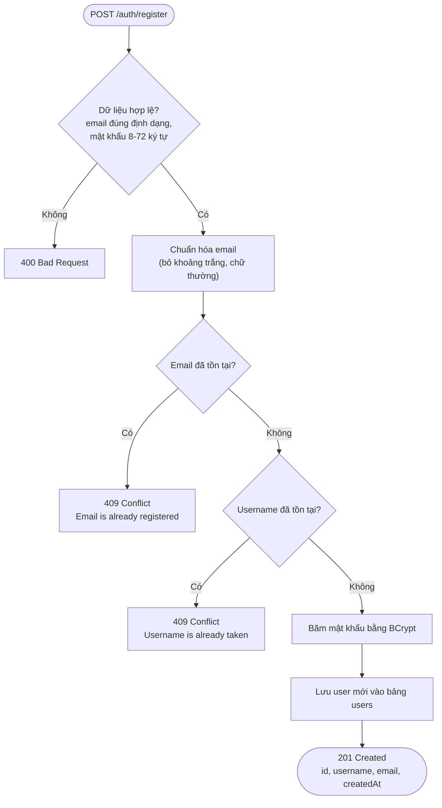
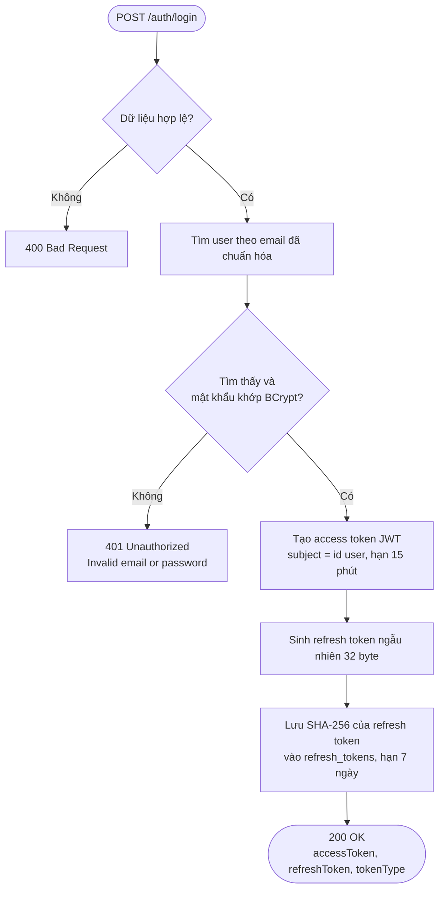
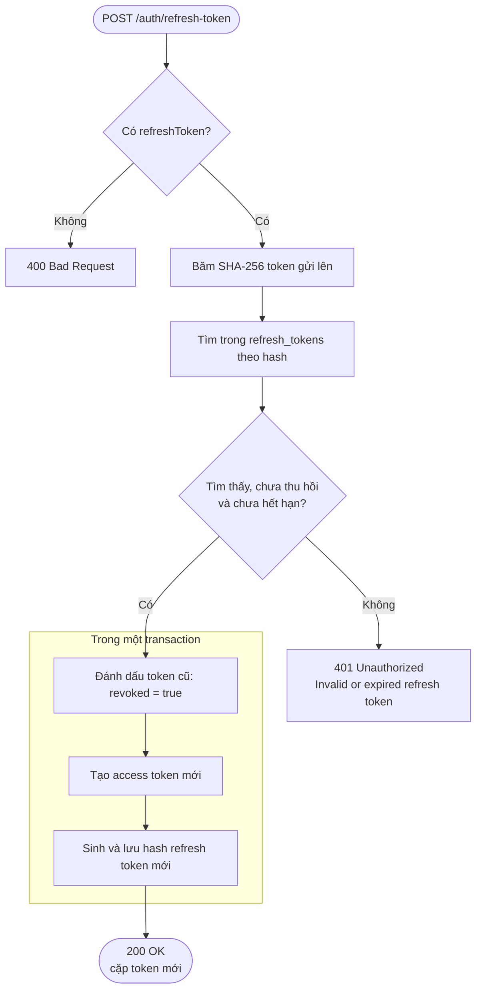
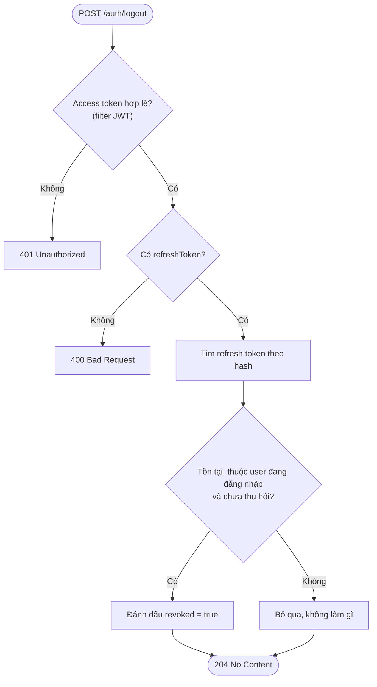
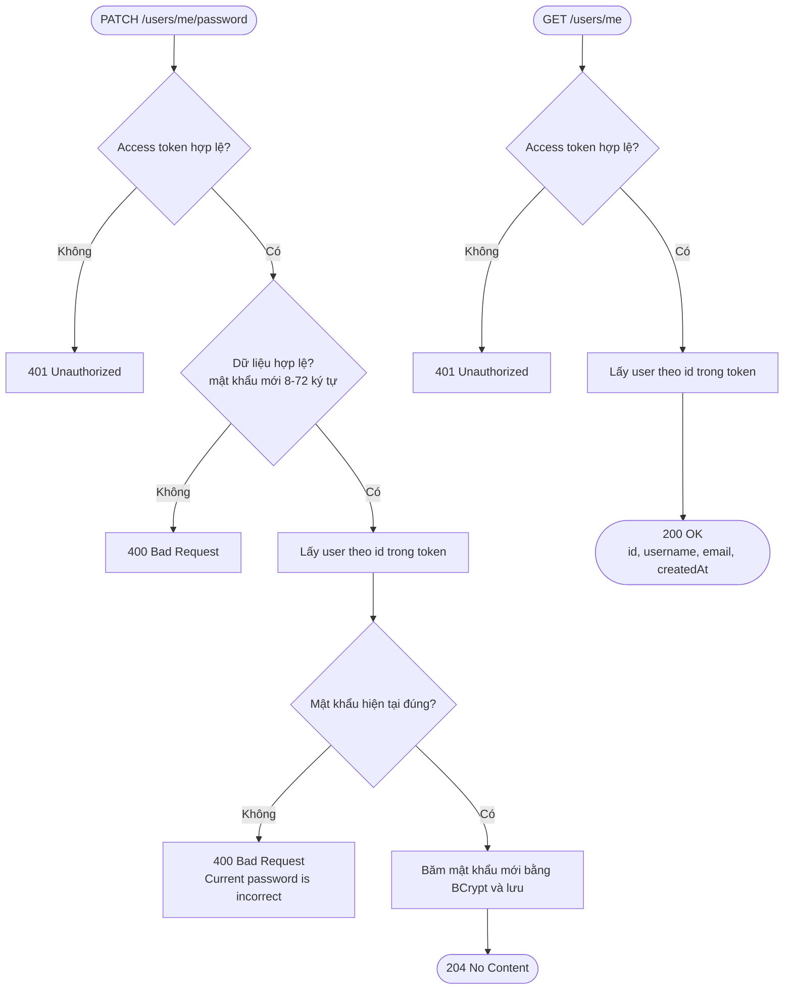
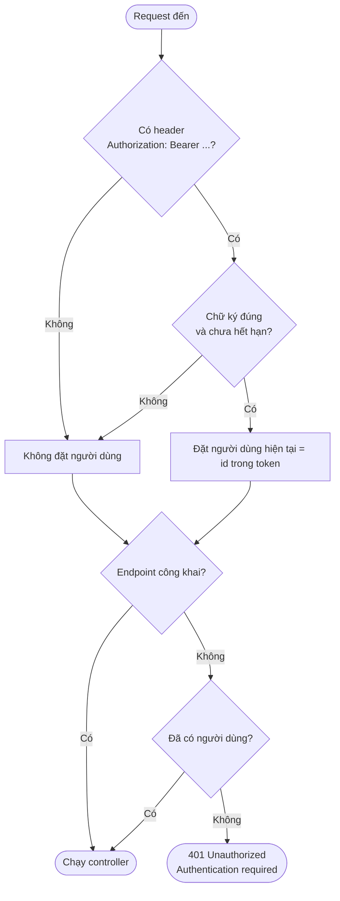

# Luồng nghiệp vụ

Flowchart các luồng chính, viết bằng [Mermaid](https://mermaid.js.org/) (GitHub tự vẽ thành hình). Mỗi thành viên bổ sung mục mình phụ trách.

- [1. Xác thực và Người dùng](#1-xác-thực-và-người-dùng)
- [2. Quản lý sơ đồ](#2-quản-lý-sơ-đồ)
- [3. Lịch sử phiên bản](#3-lịch-sử-phiên-bản)
- [4. Chia sẻ và phân quyền](#4-chia-sẻ-và-phân-quyền)

---

## 1. Xác thực và Người dùng

### 1.1. Đăng ký

### 1.2. Đăng nhập

### 1.3. Làm mới token (rotation)

### 1.4. Đăng xuất

### 1.5. Xem thông tin và đổi mật khẩu

### 1.6. Filter xác thực JWT (chạy trước mọi request)

Filter không tự chặn request: thiếu hoặc sai token thì chỉ không đặt người dùng, còn việc trả 401 do `SecurityConfig` quyết định. Nhờ vậy filter `X-Share-Token` (link chia sẻ) có thể gắn thêm mà không sửa filter này.

