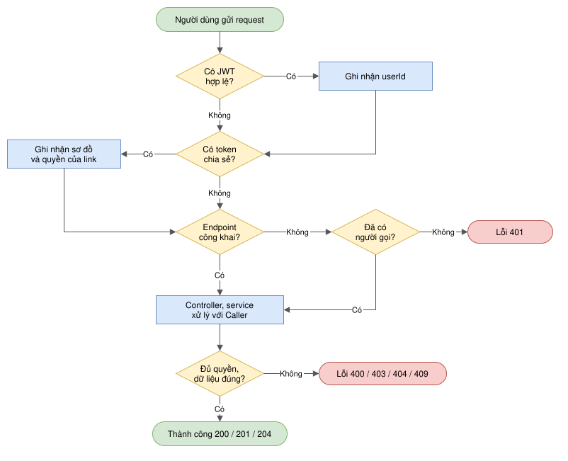
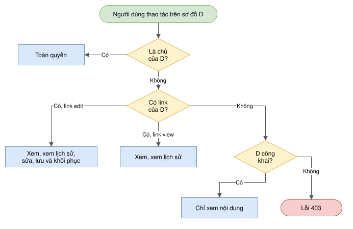
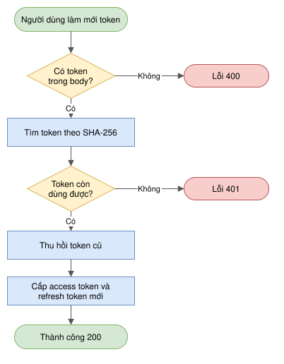
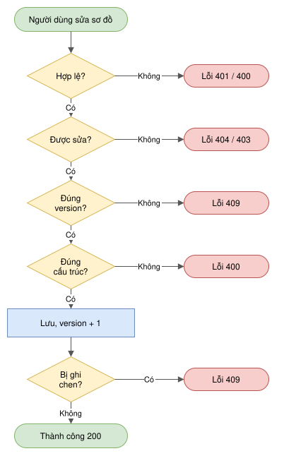
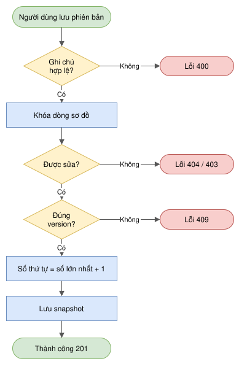
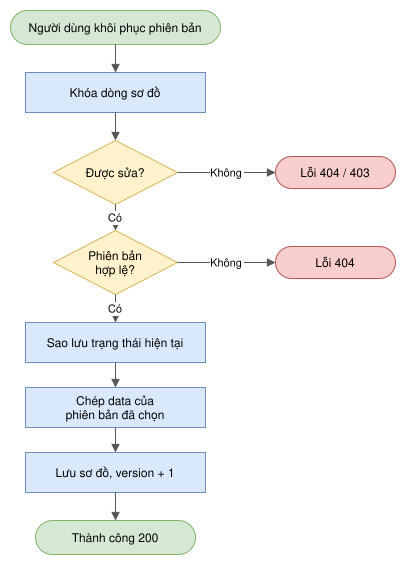
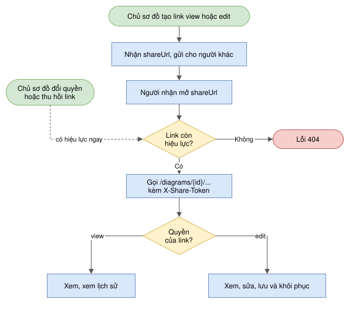

# Luồng nghiệp vụ

Tài liệu này mô tả các luồng xử lý chính của DiagramIO. Những chức năng đơn giản như đăng ký, đăng nhập, đổi mật khẩu, tạo, xóa hay xem danh sách sơ đồ không được vẽ lại ở đây, có thể xem trong [openapi.yaml](openapi.yaml) hoặc Swagger UI.

1. [Xác thực một request](#1-xác-thực-một-request)
2. [Phân quyền theo Caller](#2-phân-quyền-theo-caller)
3. [Làm mới token (rotation)](#3-làm-mới-token-rotation)
4. [Cập nhật sơ đồ (optimistic locking)](#4-cập-nhật-sơ-đồ-optimistic-locking)
5. [Lưu phiên bản (snapshot)](#5-lưu-phiên-bản-snapshot)
6. [Khôi phục phiên bản](#6-khôi-phục-phiên-bản)
7. [Vòng đời link chia sẻ](#7-vòng-đời-link-chia-sẻ)

Trong các sơ đồ, ô bo tròn màu xanh lá là điểm bắt đầu hoặc kết thúc thành công, hình chữ nhật màu xanh dương là bước xử lý, hình thoi màu vàng là điều kiện và ô bo tròn màu đỏ là kết thúc bằng lỗi. Các đường dẫn trong tài liệu viết gọn, bỏ tiền tố `/api/v1`. Khi có lỗi, API trả về JSON gồm `timestamp`, `status`, `error`, `message`, `path` và dữ liệu không bị thay đổi. Các sơ đồ là file `.drawio.svg` trong thư mục [diagrams](diagrams), mở bằng draw.io (bản web, desktop hoặc extension của VS Code) là sửa được.

| Mã | Khi nào |
|---|---|
| 400 | Dữ liệu gửi lên sai: thiếu trường, sai định dạng, `data` sai cấu trúc, `size` lớn hơn 100 |
| 401 | Chưa xác thực: không có JWT hoặc token chia sẻ hợp lệ, sai email/mật khẩu, refresh token không dùng được |
| 403 | Đã biết người gọi là ai nhưng không đủ quyền với sơ đồ |
| 404 | Không tìm thấy sơ đồ, phiên bản, link, hoặc token chia sẻ đã bị thu hồi |
| 409 | Xung đột: version sơ đồ đã thay đổi, email hoặc username đã tồn tại |

---

## 1. Xác thực một request

Endpoint: áp dụng cho mọi endpoint.

Mỗi request đi qua hai filter trước khi tới controller: filter JWT, sau đó là filter `X-Share-Token`. Hai filter này không tự chặn request. Thiếu hoặc sai token thì chỉ không xác định được người gọi, còn việc trả 401 do `SecurityConfig` quyết định. Kết quả cuối cùng là một `Caller`, gồm `userId` nếu đã đăng nhập và sơ đồ cùng quyền của link chia sẻ nếu có.

- JWT hợp lệ là JWT có chữ ký đúng và chưa hết hạn. "Có token chia sẻ" nghĩa là request có header `X-Share-Token` và token đó vẫn còn trong bảng `diagram_shares`.
- Endpoint công khai gồm đăng ký, đăng nhập, refresh token, `/health`, `/shares/{token}`, Swagger, `GET /diagrams/public` và `GET /diagrams/{id}`. Với `GET /diagrams/{id}`, người chưa đăng nhập vẫn vào được controller, sau đó service mới quyết định có cho xem hay không.
- Bước "Đủ quyền, dữ liệu đúng?" là phần kiểm tra trong service: dữ liệu gửi lên có đúng định dạng (400), quyền theo `Caller` (mục 2, không đủ thì 403), sơ đồ có tồn tại (404), version có khớp (409). Các mục sau mô tả chi tiết phần này cho từng luồng.
- Người đã đăng nhập mà vẫn gửi `X-Share-Token` thì hai thông tin được gộp lại. Nhờ vậy chủ sơ đồ mở link của chính mình vẫn giữ quyền chủ, và người sửa có đăng nhập vẫn được ghi vào `updated_by`.
- Token chia sẻ được tra trong DB ở mỗi request, nên khi chủ đổi quyền hay thu hồi link thì thay đổi có hiệu lực ngay từ request tiếp theo.

## 2. Phân quyền theo Caller

Endpoint: các endpoint thao tác trên một sơ đồ.

Toàn bộ luật quyền nằm trong `domain/access/Caller`. Service chỉ cần gọi `canView`, `canViewHistory`, `canEdit` hoặc `canManage`, không cần biết người gọi dùng JWT hay link chia sẻ.

- Chỉ chủ mới đổi được `isPublic`, xóa sơ đồ và quản lý link. Người có link edit sửa được nội dung nhưng không làm được ba việc này.
- Ô "Lỗi 403" là trường hợp đã biết người gọi nhưng không đủ quyền. Nếu endpoint bắt buộc đăng nhập mà người gọi chưa xác thực thì trả 401 ngay từ bước xác thực (mục 1).
- Sơ đồ công khai không mở lịch sử phiên bản cho người ngoài. Chủ sơ đồ có thể đã xóa thông tin nhạy cảm trước khi công khai, nhưng các snapshot cũ vẫn còn giữ thông tin đó.
- Link của sơ đồ A không có tác dụng gì với sơ đồ B.

## 3. Làm mới token (rotation)

Endpoint: `POST /auth/refresh-token`.

Access token chỉ có hạn 15 phút. Refresh token có hạn 7 ngày nhưng chỉ dùng được một lần: mỗi lần làm mới, token cũ bị thu hồi và người dùng nhận token mới. DB chỉ lưu SHA-256 của refresh token, nên dù DB bị lộ thì cũng không dùng được các token này.

- Các bước từ tìm token tới cấp token mới chạy trong một transaction. Lỗi ở bước nào cũng rollback toàn bộ, nên không xảy ra trường hợp token cũ đã bị thu hồi mà token mới chưa được lưu.
- "Token còn dùng được" nghĩa là SHA-256 của token có trong bảng `refresh_tokens`, chưa bị thu hồi và chưa hết hạn.
- Refresh token mới là chuỗi ngẫu nhiên 32 byte, DB chỉ lưu bản băm cùng hạn 7 ngày.
- Gửi lại một refresh token đã dùng sẽ nhận 401. Đăng xuất (`POST /auth/logout`) cũng chỉ là đặt `revoked = true` cho token được gửi lên.

## 4. Cập nhật sơ đồ (optimistic locking)

Endpoint: `PUT /diagrams/{id}`.

Nhiều người có thể sửa cùng một sơ đồ. Vì vậy client phải gửi kèm `version` mà mình đang thấy. Nếu người khác đã lưu trước đó (version đã tăng), server từ chối thay vì ghi đè lên thay đổi của họ.

- "Hợp lệ" gồm hai việc: đã xác thực bằng JWT hoặc `X-Share-Token` (không thì 401), và body đúng: `title` không rỗng, `diagramType` là UML hoặc ERD, có `version` và `data` (không thì 400).
- "Được sửa" gồm sơ đồ có tồn tại (không thì 404) và `caller.canEdit`, tức là chủ hoặc người có link edit (không thì 403). "Đúng version" là `version` gửi lên bằng `version` trong DB.
- `data` phải là object có mảng `nodes` và `edges`, tối đa 2 MB.
- Khi lưu, chỉ chủ đổi được `isPublic`; người sửa qua link gửi giá trị khác thì vẫn giữ giá trị cũ. `updatedBy` là người đăng nhập, để NULL nếu sửa qua link mà không đăng nhập.
- Có hai lớp chống ghi đè: so sánh version trong code, và điều kiện `WHERE version = ...` của JPA `@Version` lúc ghi. Lớp thứ hai bắt được trường hợp hai request cùng qua bước so sánh gần như cùng lúc.
- Khi nhận 409, client tải lại sơ đồ bằng `GET` để lấy version mới rồi sửa lại.

## 5. Lưu phiên bản (snapshot)

Endpoint: `POST /diagrams/{id}/versions`.

Snapshot là bản chụp cố định của `data` tại thời điểm lưu, được đánh số 1, 2, 3... riêng cho từng sơ đồ. Luồng này phải xử lý trường hợp nhiều người lưu cùng lúc, đồng thời bảo đảm bản chụp đúng là nội dung người lưu đang thấy.

- "Ghi chú hợp lệ" là `note` không quá 255 ký tự. "Được sửa" giống mục 4. "Đúng version" chỉ được kiểm tra khi client có gửi `version`.
- Từ bước khóa dòng tới bước lưu snapshot chạy trong một transaction. Dòng sơ đồ bị khóa bằng `SELECT ... FOR UPDATE` nên các request lưu cùng lúc trên cùng sơ đồ phải xếp hàng, không ai lấy trùng số thứ tự. Ràng buộc `UNIQUE (diagram_id, version_number)` là lớp bảo vệ cuối cùng, nếu vẫn trùng thì trả 409.
- Trường `version` gửi kèm giúp tránh tình huống: An vừa `PUT` xong, Bình sửa chen vào, rồi request lưu của An lại chụp nhầm nội dung của Bình. Việc so version diễn ra sau khi đã khóa, nên không ai chen vào được giữa lúc so và lúc chụp.
- Snapshot lưu `data` hiện tại, ghi chú và `createdBy` (để NULL nếu tạo qua link mà không đăng nhập).

## 6. Khôi phục phiên bản

Endpoint: `POST /diagrams/{id}/versions/{versionId}/restore`.

Khôi phục là chép `data` của một snapshot cũ vào sơ đồ hiện tại. Theo đặc tả, trạng thái hiện tại phải được tự động sao lưu trước, để nếu khôi phục nhầm thì vẫn lấy lại được.

- "Được sửa" giống mục 4. "Phiên bản hợp lệ" là phiên bản tồn tại và thuộc đúng sơ đồ này.
- Toàn bộ luồng chạy trong một transaction. Bản sao lưu được tạo trước rồi mới ghi đè, nên không bao giờ có lúc sơ đồ đã bị ghi đè mà chưa có bản sao lưu. Bản sao lưu có ghi chú `Auto backup before restoring version N`.
- Chỉ phần `data` được khôi phục; tiêu đề, loại sơ đồ và `isPublic` giữ nguyên. Các snapshot cũ không bị sửa hay xóa.
- Response trả về cả sơ đồ sau khi khôi phục và snapshot sao lưu vừa tạo.

## 7. Vòng đời link chia sẻ

Endpoint: `POST /diagrams/{id}/shares` (tạo link), `GET /shares/{token}` (mở link), `PATCH` và `DELETE /diagrams/{id}/shares/{shareId}` (đổi quyền, thu hồi).

Chia sẻ hoạt động giống Google Docs: chủ sơ đồ tạo link với quyền view hoặc edit, ai có link thì dùng được, không bắt buộc đăng nhập.

- Token là chuỗi ngẫu nhiên 24 byte (48 ký tự hex), `role` là `view` hoặc `edit`.
- `shareUrl` được tạo từ địa chỉ server đang nhận request (localhost, Docker hay máy chủ thật) và trỏ tới `GET /shares/{token}`, vì pha 1 chưa có frontend.
- Thu hồi xóa hẳn link, nên từ request sau mở link sẽ nhận 404 và header `X-Share-Token` bị bỏ qua.
- Người dùng link mà không đăng nhập thì `updated_by` và `created_by` để NULL. Nhiều người dùng chung một link thì không phân biệt được ai với ai; việc này để sang pha 2, khi làm cộng tác thời gian thực.
- Chỉ chủ sơ đồ quản lý được link. Người cầm link edit mà gọi các endpoint `/shares` sẽ nhận 401 hoặc 403.
