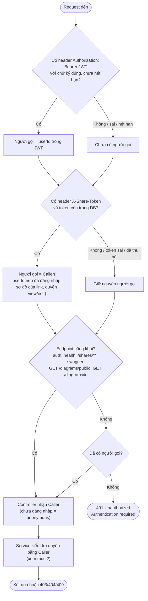
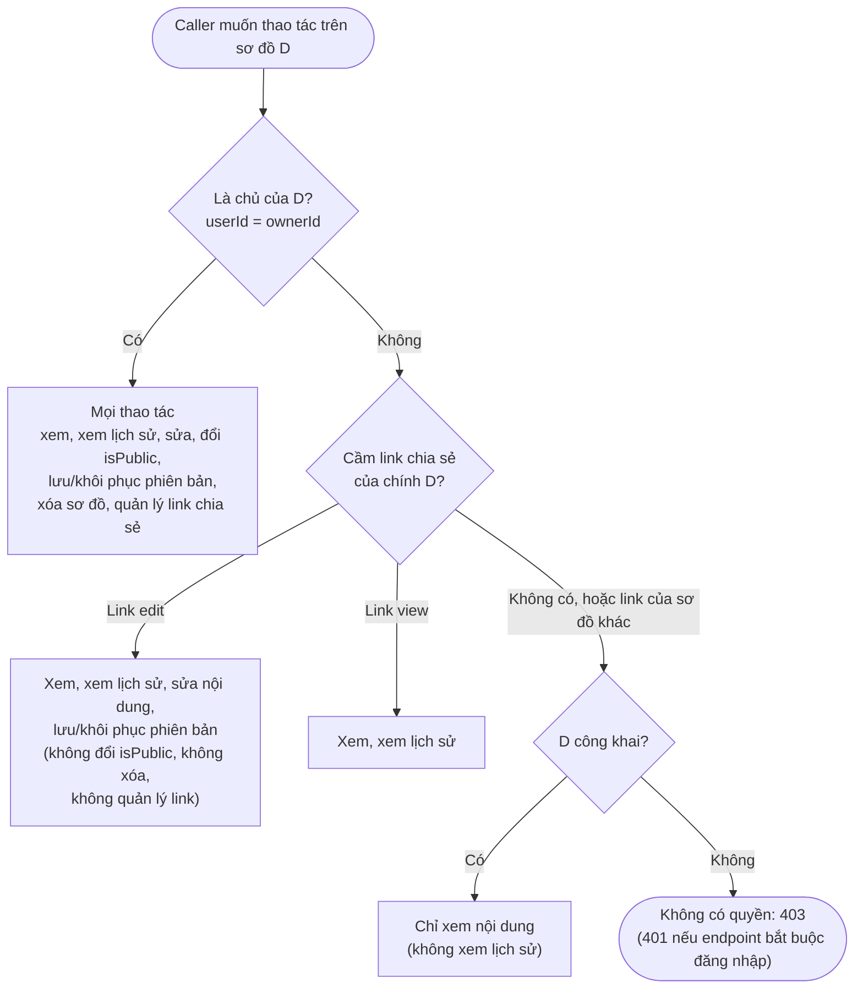
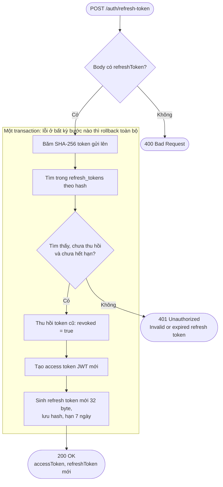
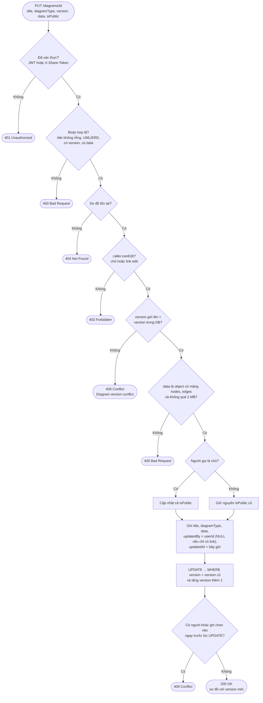
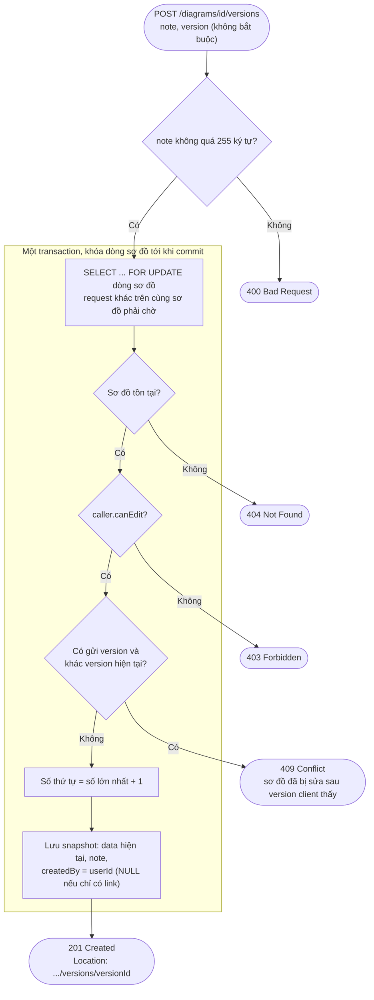
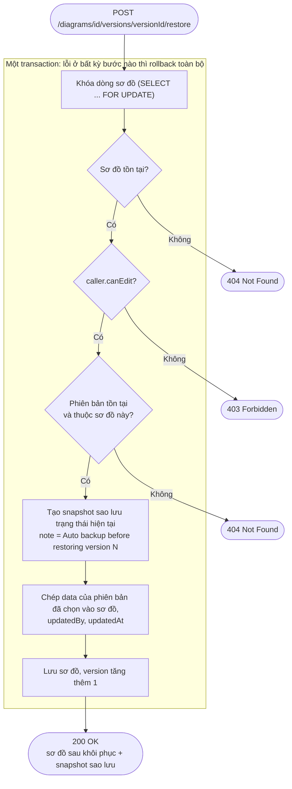
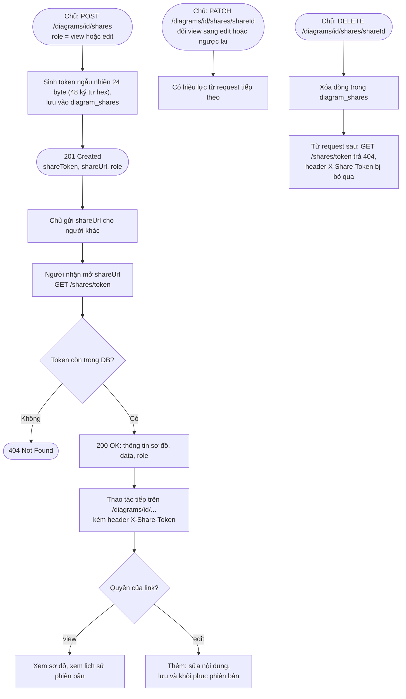

# Luồng nghiệp vụ

Tài liệu này mô tả các luồng xử lý chính của DiagramIO. Những chức năng đơn giản như đăng ký, đăng nhập, đổi mật khẩu, tạo, xóa hay xem danh sách sơ đồ không được vẽ lại ở đây, có thể xem trong [openapi.yaml](openapi.yaml) hoặc Swagger UI.

1. [Xác thực một request](#1-xác-thực-một-request)
2. [Phân quyền theo Caller](#2-phân-quyền-theo-caller)
3. [Làm mới token (rotation)](#3-làm-mới-token-rotation)
4. [Cập nhật sơ đồ (optimistic locking)](#4-cập-nhật-sơ-đồ-optimistic-locking)
5. [Lưu phiên bản (snapshot)](#5-lưu-phiên-bản-snapshot)
6. [Khôi phục phiên bản](#6-khôi-phục-phiên-bản)
7. [Vòng đời link chia sẻ](#7-vòng-đời-link-chia-sẻ)

Trong các sơ đồ, hình bo tròn là điểm bắt đầu hoặc kết thúc, hình thoi là điều kiện, hình chữ nhật là bước xử lý. Khi có lỗi, API trả về JSON gồm `timestamp`, `status`, `error`, `message`, `path`.

| Mã | Khi nào |
|---|---|
| 400 | Dữ liệu gửi lên sai: thiếu trường, sai định dạng, `data` sai cấu trúc, `size` lớn hơn 100 |
| 401 | Chưa xác thực: không có JWT hoặc token chia sẻ hợp lệ, sai email/mật khẩu, refresh token không dùng được |
| 403 | Đã biết người gọi là ai nhưng không đủ quyền với sơ đồ |
| 404 | Không tìm thấy sơ đồ, phiên bản, link, hoặc token chia sẻ đã bị thu hồi |
| 409 | Xung đột: version sơ đồ đã thay đổi, email hoặc username đã tồn tại |

---

## 1. Xác thực một request

Mỗi request đi qua hai filter trước khi tới controller: filter JWT, sau đó là filter `X-Share-Token`. Hai filter này không tự chặn request. Thiếu hoặc sai token thì chỉ không xác định được người gọi, còn việc trả 401 do `SecurityConfig` quyết định. Kết quả cuối cùng là một `Caller`, gồm `userId` nếu đã đăng nhập và sơ đồ cùng quyền của link chia sẻ nếu có.

- Người đã đăng nhập mà vẫn gửi `X-Share-Token` thì hai thông tin được gộp lại. Nhờ vậy chủ sơ đồ mở link của chính mình vẫn giữ quyền chủ, và người sửa có đăng nhập vẫn được ghi vào `updated_by`.
- Token chia sẻ được tra trong DB ở mỗi request, nên khi chủ đổi quyền hay thu hồi link thì thay đổi có hiệu lực ngay từ request tiếp theo.

## 2. Phân quyền theo Caller

Toàn bộ luật quyền nằm trong `domain/access/Caller`. Service chỉ cần gọi `canView`, `canViewHistory`, `canEdit` hoặc `canManage`, không cần biết người gọi dùng JWT hay link chia sẻ.

| Hàm | Đúng khi | Dùng cho |
|---|---|---|
| `canManage` | là chủ | `DELETE /diagrams/{id}`, mọi `/diagrams/{id}/shares...`, đổi `isPublic` |
| `canEdit` | `canManage`, hoặc có link edit của chính sơ đồ | `PUT /diagrams/{id}`, `POST .../versions`, `POST .../restore` |
| `canViewHistory` | `canEdit`, hoặc có link view của chính sơ đồ | `GET .../versions`, `GET .../versions/{versionId}` |
| `canView` | `canViewHistory`, hoặc sơ đồ đang công khai | `GET /diagrams/{id}` |

- Sơ đồ công khai không mở lịch sử phiên bản cho người ngoài. Chủ sơ đồ có thể đã xóa thông tin nhạy cảm trước khi công khai, nhưng các snapshot cũ vẫn còn giữ thông tin đó.
- Link của sơ đồ A không có tác dụng gì với sơ đồ B.

## 3. Làm mới token (rotation)

Access token chỉ có hạn 15 phút. Refresh token có hạn 7 ngày nhưng chỉ dùng được một lần: mỗi lần làm mới, token cũ bị thu hồi và người dùng nhận token mới. DB chỉ lưu SHA-256 của refresh token, nên dù DB bị lộ thì cũng không dùng được các token này.

- Gửi lại một refresh token đã dùng sẽ nhận 401. Đăng xuất (`POST /auth/logout`) cũng chỉ là đặt `revoked = true` cho token được gửi lên.
- Việc thu hồi token cũ và lưu token mới nằm chung một transaction, nên không xảy ra trường hợp token cũ đã mất mà token mới chưa được lưu.

## 4. Cập nhật sơ đồ (optimistic locking)

Nhiều người có thể sửa cùng một sơ đồ. Vì vậy client phải gửi kèm `version` mà mình đang thấy. Nếu người khác đã lưu trước đó (version đã tăng), server từ chối thay vì ghi đè lên thay đổi của họ.

- Có hai lớp chống ghi đè: so sánh version trong code, và điều kiện `WHERE version = ...` của JPA `@Version` lúc ghi. Lớp thứ hai bắt được trường hợp hai request cùng qua bước so sánh gần như cùng lúc.
- Khi nhận 409, client tải lại sơ đồ bằng `GET` để lấy version mới rồi sửa lại.

## 5. Lưu phiên bản (snapshot)

Snapshot là bản chụp cố định của `data` tại thời điểm lưu, được đánh số 1, 2, 3... riêng cho từng sơ đồ. Luồng này phải xử lý trường hợp nhiều người lưu cùng lúc, đồng thời bảo đảm bản chụp đúng là nội dung người lưu đang thấy.

- Dòng sơ đồ bị khóa để các request lưu cùng lúc phải xếp hàng, không ai lấy trùng số thứ tự. Ràng buộc `UNIQUE (diagram_id, version_number)` là lớp bảo vệ cuối cùng, nếu vẫn trùng thì trả 409.
- Trường `version` gửi kèm giúp tránh tình huống: An vừa `PUT` xong, Bình sửa chen vào, rồi request lưu của An lại chụp nhầm nội dung của Bình. Việc so version diễn ra sau khi đã khóa, nên không ai chen vào được giữa lúc so và lúc chụp.

## 6. Khôi phục phiên bản

Khôi phục là chép `data` của một snapshot cũ vào sơ đồ hiện tại. Theo đặc tả, trạng thái hiện tại phải được tự động sao lưu trước, để nếu khôi phục nhầm thì vẫn lấy lại được.

- Bản sao lưu được tạo trước rồi mới ghi đè, và cả hai bước nằm trong cùng một transaction. Vì vậy không bao giờ có lúc sơ đồ đã bị ghi đè mà chưa có bản sao lưu.
- Chỉ phần `data` được khôi phục; tiêu đề, loại sơ đồ và `isPublic` giữ nguyên. Các snapshot cũ không bị sửa hay xóa.

## 7. Vòng đời link chia sẻ

Chia sẻ hoạt động giống Google Docs: chủ sơ đồ tạo link với quyền view hoặc edit, ai có link thì dùng được, không bắt buộc đăng nhập.

- `shareUrl` được tạo từ địa chỉ server đang nhận request (localhost, Docker hay máy chủ thật) và trỏ tới `GET /api/v1/shares/{token}`, vì pha 1 chưa có frontend.
- Người dùng link mà không đăng nhập thì `updated_by` và `created_by` để NULL. Nhiều người dùng chung một link thì không phân biệt được ai với ai; việc này để sang pha 2, khi làm cộng tác thời gian thực.
- Chỉ chủ sơ đồ quản lý được link. Người cầm link edit mà gọi các endpoint `/shares` sẽ nhận 401 hoặc 403.
